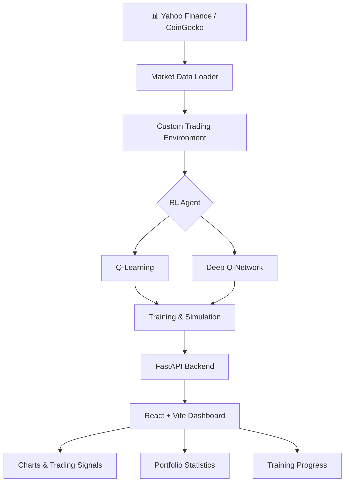

# ⚡ RL Trading System

<p align="center">
  <strong>Teaching Machines to Make Trading Decisions.</strong>
  <br>
  A full-stack Reinforcement Learning platform for training, simulating, and visualizing intelligent trading agents.
</p>

<p align="center">
  
  
  
  
  
  
</p>

---

## 🧠 Overview

**RL Trading System** is a full-stack Reinforcement Learning project that explores how an intelligent agent can learn simplified trading decisions from historical market data.

The agent interacts with a custom trading environment, observes market-related states, and chooses between three actions: **Hold, Buy, or Sell**. Through repeated training episodes, it learns action values based on the rewards defined by the environment.

The platform combines a Python backend with an interactive React dashboard, making it possible to train agents, monitor progress, simulate trading behavior, and visualize portfolio performance.

## ✨ Key Features

- 🧠 **Reinforcement Learning** — Experiment with tabular Q-Learning and Deep Q-Networks (DQN).
- 📈 **Market Data Integration** — Load historical stock and cryptocurrency prices.
- 🎮 **Custom Trading Environment** — Simulate trading actions, balances, holdings, rewards, and portfolio values.
- ⚡ **Training Progress** — Track episodes, rewards, and training status through the API.
- 📊 **Interactive Dashboard** — Visualize price movements, portfolio values, and trade signals.
- 💹 **Portfolio Analytics** — Review final portfolio value, profit or loss, returns, and trade counts.
- 🔌 **FastAPI Backend** — Expose training, simulation, status, and health endpoints.
- ⚛️ **React Frontend** — Explore the system through a dedicated user interface.
- 🔄 **Market Data Fallback** — Use demo data if live data retrieval fails.
- 🧪 **Algorithm Comparison** — Compare a table-based learning approach with a neural-network-based approach.

## 🏗️ System Architecture



### How It Works

1. **Load market data** from supported data sources or use fallback demo data.
2. **Construct the environment** using price history, account balance, and current holdings.
3. **Observe the state** representing recent price movement and portfolio conditions.
4. **Select an action** using Q-Learning or DQN.
5. **Calculate the reward** according to the environment's reward function.
6. **Train the agent** over multiple episodes.
7. **Run a simulation** and visualize the resulting trades and portfolio statistics.

## 🎮 Trading Environment

The custom `TradingEnv` environment defines the agent's interaction with the simulated market.

### Available Actions

| Action | Decision | Description |
|---:|---|---|
| `0` | Hold | Maintain the current position |
| `1` | Buy | Attempt to purchase shares |
| `2` | Sell | Attempt to sell shares |

### Environment Responsibilities

- Represent recent price movements in the state.
- Track available balance and shares held.
- Process buy and sell actions.
- Calculate rewards and realized profit or loss.
- Calculate portfolio value.
- Determine when an episode ends.

The reward function is a central part of the environment: it influences which actions the agent learns to prefer. Invalid actions can also affect rewards according to the environment's implementation.

## 🤖 Reinforcement Learning Algorithms

### 1. Q-Learning

Q-Learning is a model-free reinforcement learning algorithm that learns the expected value of taking an action in a particular state.

This implementation uses a Q-table. Since market states contain continuous numerical information, the agent discretizes relevant state values into bins.

**Advantages**
- Relatively simple to implement.
- Useful for understanding reinforcement learning fundamentals.
- Can be fast for small, discretized state spaces.

**Limitations**
- Requires state discretization.
- The table can grow substantially as the state space expands.
- Generalization to unseen states is limited.

### 2. Deep Q-Network (DQN)

DQN uses a neural network to approximate action values instead of storing every state-action value in a table.

The implementation includes:

- `DQNNetwork` — Neural network used to estimate Q-values.
- `DQNAgent` — Agent responsible for selecting actions and learning.
- **Replay memory** — Reuses past transitions during training.
- **Target network** — Helps stabilize the learning process.

**Advantages**
- Can generalize across similar numerical states.
- Avoids maintaining a large explicit Q-table.
- Supports more expressive state representations.

**Limitations**
- Requires more computation and careful tuning.
- Training can be sensitive to hyperparameters and reward design.
- Better function approximation does not guarantee better trading performance.

## 📂 Project Structure

```text
rl-trading/
├── backend/
│   ├── main.py              # FastAPI server and endpoints
│   ├── env.py               # Custom trading environment
│   ├── q_learning.py        # Tabular Q-Learning agent
│   ├── dqn.py               # DQN network and agent
│   ├── data_loader.py       # Market data loading
│   └── requirements.txt     # Backend dependencies
│
├── frontend/
│   ├── src/
│   │   ├── App.tsx          # Application entry and navigation
│   │   ├── index.css        # Global styles
│   │   └── pages/
│   │       ├── Hero.tsx     # Landing page
│   │       ├── Dashboard.tsx# Training and simulation controls
│   │       ├── Chart.tsx    # Price and portfolio visualization
│   │       └── Stats.tsx    # Performance statistics
│   ├── package.json
│   ├── vite.config.js
│   └── tsconfig.json
│
└── README.md
```

## 🛠️ Tech Stack

| Technology | Purpose |
|---|---|
| **Python** | Backend and agent implementation |
| **FastAPI** | API endpoints and request handling |
| **Uvicorn** | ASGI server |
| **NumPy** | Numerical operations |
| **PyTorch** | Neural network implementation for DQN |
| **yfinance** | Historical market data |
| **Pandas** | Market data manipulation |
| **Pydantic** | Request and response validation |
| **React** | Frontend user interface |
| **TypeScript** | Frontend type safety |
| **Vite** | Frontend development server |
| **Tailwind CSS** | UI styling |
| **Recharts** | Charts and data visualization |
| **CoinGecko** | Cryptocurrency price data source |

## 🚀 Getting Started

### Prerequisites

Make sure you have installed:

- Python
- Node.js and npm
- Git

### 1. Clone the Repository

```bash
git clone <your-repository-url>
cd rl-trading
```

Replace the placeholder with your repository URL and enter the actual project directory.

### 2. Start the Backend

Open a terminal:

```bash
cd backend
python -m venv venv
```

Activate the environment on Windows:

```powershell
venv\Scripts\activate
```

On macOS or Linux:

```bash
source venv/bin/activate
```

Install dependencies:

```bash
pip install -r requirements.txt
```

Start FastAPI:

```bash
uvicorn main:app --host 0.0.0.0 --port 8000 --reload
```

Backend URL:

**http://localhost:8000**

### 3. Start the Frontend

Open a second terminal from the project root:

```bash
cd frontend
npm install
npm run dev
```

Open the local URL printed by Vite in the terminal. The configured port may differ from the default.

> Ensure the frontend's API base URL matches the backend address and that CORS is configured appropriately for local development.

## 🔌 API Reference

Base URL:

```text
http://localhost:8000/rl-api
```

### Train an Agent

`POST /train`

Example request:

```json
{
  "ticker": "AAPL",
  "algorithm": "q_learning",
  "episodes": 30,
  "period": "3mo"
}
```

The endpoint returns a task ID that can be used to monitor training progress.

### Check Training Status

`GET /train/status/{task_id}`

The response provides information such as:

- Training status
- Progress
- Current episode
- Total episodes
- Last reward
- Number of data points

### Run a Simulation

`POST /simulate`

Example request:

```json
{
  "ticker": "AAPL",
  "algorithm": "q_learning"
}
```

The simulation response includes:

- Price history
- Portfolio values
- Buy and sell signals
- Final portfolio statistics

### Health Check

`GET /healthz`

Example response:

```json
{
  "status": "ok"
}
```

For exact request schemas and response details, refer to the backend implementation.

## 📈 Dashboard Workflow

1. Open the frontend.
2. Select **ENTER DASHBOARD**.
3. Choose a supported ticker.
4. Select `Q-Learning` or `DQN`.
5. Configure the number of training episodes and historical data period.
6. Start training.
7. Monitor training progress and any reported errors.
8. Run a simulation.
9. Review the price chart, trade signals, portfolio value, and statistics.

## 📊 Performance Metrics

The dashboard reports:

| Metric | Meaning |
|---|---|
| Final Portfolio Value | Portfolio value at the end of the simulation |
| Total Profit / Loss | Difference between final and initial portfolio value, subject to the implementation's accounting rules |
| Return Percentage | Portfolio change expressed as a percentage |
| Total Trades | Number of trades reported by the simulation |

These statistics describe the simulation. They do not, by themselves, establish that an agent will perform well on unseen market data.

## 💡 Key Concepts Explored

- Reinforcement Learning fundamentals
- State, action, and reward design
- Q-values and Q-tables
- State discretization
- Neural-network function approximation
- Experience replay and target networks
- Training episodes and agent evaluation
- Market data processing
- Portfolio value and trading signals
- Frontend/backend integration
- Interactive financial data visualization

## ⚠️ Limitations & Disclaimer

This is an **educational reinforcement learning project**, not a production-ready trading system or financial adviser.

The current simulation is simplified and does not include real trading fees, slippage, comprehensive risk management, or live order execution.

Additional considerations:

- Historical performance does not guarantee future results.
- Agents may overfit to the data used during training.
- Reward design can produce undesirable trading behavior.
- Results depend on data quality, environment assumptions, and training settings.
- Realistic evaluation requires out-of-sample testing and careful risk analysis.

Do not use the simulation's results as the sole basis for financial decisions.

## 🔮 Future Improvements

Potential extensions include:

- Persisting trained models to disk.
- Adding transaction costs and slippage.
- Comparing results against buy-and-hold benchmarks.
- Calculating Sharpe ratio and maximum drawdown.
- Incorporating technical indicators.
- Expanding ticker and market support.
- Tracking historical training and simulation results.
- Adding authentication and user-specific sessions.
- Deploying the frontend and backend online.

These are possible future enhancements, not claims about currently implemented features.

---

<p align="center">
  <strong>Observe the market. Learn from rewards. Evaluate every decision.</strong>
  <br><br>
  Built with Python, Reinforcement Learning, FastAPI, and React.
</p>
